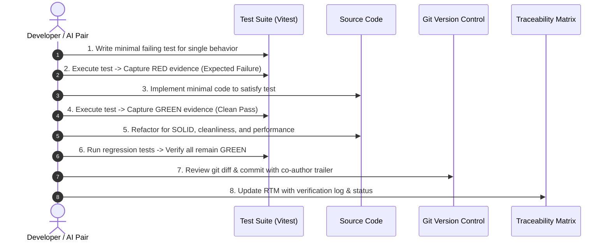

# Phase 00: TDD Protocol, Quality Assurance & Git Collaboration Standard

**Project:** Incubyte Car Dealership Inventory System  
**Document Status:** Strict Engineering Standard (Phase 00)  
**Methodology:** Test-Driven Development (Red-Green-Refactor)

---

## 1. Test-Driven Development (TDD) Lifecycle Protocol

Every single software feature, validation check, and endpoint in this repository must strictly adhere to the classical **Red-Green-Refactor** development cycle.



### 1.1 Step-by-Step TDD Rules

1. **Phase 1: RED (Failing Test First)**
   - Formulate the precise requirement to be proven.
   - Write a unit or integration test specifying the expected behavior before creating the implementation.
   - Run the test suite and confirm it **fails for the exact reason expected** (e.g. `VehicleService.create is not a function` or `Expected 409 Conflict, received 404`).
   - _Evidence Retention:_ Retain terminal output showing the failed assertion.

2. **Phase 2: GREEN (Smallest Passing Implementation)**
   - Write only the minimal necessary code required to turn the failing test green.
   - Avoid speculative coding or anticipatory abstractions.
   - Re-run the test suite and confirm that all tests pass cleanly.
   - _Evidence Retention:_ Retain terminal output showing zero failures.

3. **Phase 3: REFACTOR (Code Craftsmanship)**
   - Clean up code duplication, extract magic numbers, enhance variable naming, and align with SOLID principles.
   - Run the complete test suite to prove that no regressions were introduced.
   - Review the Git diff (`git diff`) to ensure zero stray changes or accidental formatting noise.

4. **Phase 4: COMMIT & LOG**
   - Stage the specific files (`git add <files>`).
   - Create a commit using Conventional Commits with AI co-authorship trailer.
   - Update `docs/02_REQUIREMENTS_TRACEABILITY_MATRIX.md` with status `VERIFIED`.

---

## 2. Integrity & Anti-Fabrication Safeguards

- **No Retrofitted Tests:** Generating application logic first and creating tests afterward violates the core assessment standard and is strictly prohibited.
- **Zero Fabricated Evidence:** Never simulate or invent test outputs, pass percentages, or mock execution summaries. All logs must be real terminal outputs from `npm test` or `vitest run`.
- **Environment Failure vs. Test Failure:** If a test fails due to network disconnection, missing database daemon, or syntax error in test setup, it must **never** be counted as a legitimate RED cycle. Test infrastructure issues must be isolated, diagnosed, and resolved before resuming TDD.

---

## 3. Git Workflow & AI Co-Authorship Standard

### 3.1 Conventional Commit Format

All commits follow the Angular/Conventional Commits specification:

```text
<type>(<scope>): <short description>

[optional body explaining motivation and design decisions]

Co-authored-by: Google Antigravity <noreply@google.com>
```

- **Types:**
  - `feat`: A new user-facing feature or API capability.
  - `test`: Adding missing tests or correcting test suites.
  - `refactor`: Code change that neither fixes a bug nor adds a feature.
  - `docs`: Documentation updates only.
  - `chore`: Tooling, build config, or dependency updates.
  - `fix`: Bug fix.

### 3.2 AI Co-Authorship Trailer

The assignment explicitly requires AI co-authorship for every AI-assisted commit. Git natively recognizes co-authors via commit message trailers formatted as:

```text
Co-authored-by: Google Antigravity <noreply@google.com>
```

- Each AI-assisted commit will conclude with this exact trailer, ensuring proper attribution in GitHub commit history and insight graphs without unintended profile collision.

---

## 4. Root-Level `PROMPTS.md` Transparency Protocol

To satisfy the mandatory requirement for interview readiness and AI disclosure:

1. **Location:** `PROMPTS.md` located directly at the repository root.
2. **Contents:**
   - Raw, unedited user prompt prompts and corresponding assistant high-level action summaries.
   - Chronological timestamps for every major phase and interaction.
   - Zero sanitization or post-hoc editing that obscures the true nature of the AI collaboration.
3. **Security Check:** Automated check to ensure no API keys, private credentials, or personal secrets are recorded into `PROMPTS.md`.

---

## 5. Automated CI/CD Testing Pipeline (GitHub Actions)

A GitHub Actions workflow `.github/workflows/ci.yml` will automatically validate every push:

1. **Lint & Format Check:** `npm run lint` and `npm run format:check`.
2. **Type Check:** `tsc --noEmit` across both frontend and backend.
3. **Database Integration Container:** Spins up `mongo:7.0` container on port 27017.
4. **Backend Test Suite:** Executes `npm run test:backend` with real Mongo service.
5. **Frontend Test Suite:** Executes `npm run test:frontend` via Vitest + RTL.
6. **Production Build:** Builds backend (`npm run build:backend`) and frontend (`npm run build:frontend`).
