# Phase 00: Phased Implementation Plan & Risk Register

**Project:** Incubyte Car Dealership Inventory System  
**Document Status:** Baseline Roadmap (Phase 00)  
**Standard:** Strict TDD Milestones with Explicit Exit Gates

---

## 1. Phased Roadmap Overview

```mermaid
gantt
    title Incubyte Dealership Implementation Roadmap
    dateFormat  X
    axisFormat  Day %d
    section Planning
    Phase 00 Audit & Planning :active, 0, 1
    section Infrastructure
    Phase 01 Scaffolding & CI :1, 2
    section Backend TDD
    Phase 02 Auth & RBAC :2, 4
    Phase 03 Vehicles & Inventory :4, 6
    section Frontend TDD
    Phase 04 UI & Admin Portal :6, 8
    section Verification
    Phase 05 E2E & Documentation :8, 9
    section Optional
    Phase 06 Containerization :9, 10
```

---

## 2. Phase-by-Phase Breakdown & Verifiable Exit Criteria

### Phase 00: Repository Audit & Engineering Contract (CURRENT)

- **Objective:** Audit workspace, establish architecture, lock dependencies, create requirements traceability matrix, define TDD/Git/AI rules, and draft UI design brief.
- **Exit Criteria:**
  - [x] Workspace and remote repository factually audited without modifying existing state.
  - [x] Technology stack evaluated, compatibility checked, and locked.
  - [x] Bidirectional Requirements Traceability Matrix (RTM) created.
  - [x] All 10 architectural ambiguities analyzed with defensible decisions.
  - [x] Strict TDD lifecycle, Git co-authorship standard, and PROMPTS.md rules codified.
  - [x] UI/UX design contract and token palette established.
  - [x] Planning documents safely written to `docs/` without creating application source code.
  - [x] Waiting for explicit user approval before advancing to Phase 01.

---

### Phase 01: Monorepo Scaffolding, Toolchain & CI Pipeline

- **Objective:** Initialize Git repository, configure project root, set up `/backend` (Express/TS/Vitest) and `/frontend` (React/Vite/Tailwind/Vitest), and create GitHub Actions CI workflow.
- **Tasks:**
  1. Initialize Git repository with default branch `main`. Set remote `origin`.
  2. Create root `.gitignore`, `.prettierrc`, and initial `PROMPTS.md`.
  3. Initialize `/backend` with `package.json`, `tsconfig.json`, `vitest.config.ts`, ESLint, and a baseline health check endpoint (`GET /health`).
  4. Initialize `/frontend` with Vite, React 18, TypeScript, Tailwind CSS, `vitest.config.ts`, and a baseline smoke test.
  5. Configure `.github/workflows/ci.yml` with MongoDB service container, lint, typecheck, and test runs.
- **Exit Criteria:**
  - `npm run test` executes and passes health checks in both backend and frontend.
  - `npm run lint` and `npm run typecheck` report zero errors.
  - Initial baseline commit made with proper AI co-authorship trailer.

---

### Phase 02: Authentication, Security & RBAC (Backend TDD)

- **Objective:** Implement user registration, secure password hashing, JWT authentication, and role-based access control following strict TDD.
- **Tasks:**
  1. _Test First:_ Write unit tests for `User` model (schema validation, bcrypt hashing, JSON password sanitization).
  2. Implement `User` model and verify tests turn GREEN.
  3. _Test First:_ Write Supertest integration tests for `POST /api/auth/register` (valid registration, duplicate email rejection, role escalation prevention).
  4. Implement `auth.service.ts` and `auth.controller.ts` for registration. Verify GREEN.
  5. _Test First:_ Write Supertest tests for `POST /api/auth/login` (correct credentials return JWT, invalid return 401).
  6. Implement login logic and JWT token generation. Verify GREEN.
  7. _Test First:_ Write Supertest tests for `authenticateJwt` and `requireRole('admin')` middleware.
  8. Implement auth middleware. Verify GREEN.
  9. Implement admin seeding script (`npm run seed:admin`) reading from environment variables.
- **Exit Criteria:**
  - 100% test pass rate for authentication and authorization suite.
  - Evidence captured for RED, GREEN, and REFACTOR cycles.
  - Traceability matrix updated for `REQ-AUTH-01` through `REQ-AUTH-04`.

---

### Phase 03: Vehicle Inventory, Search & Atomic Purchase (Backend TDD)

- **Objective:** Implement vehicle CRUD, compound search/filter, atomic inventory decrement, and admin restocking using strict TDD.
- **Tasks:**
  1. _Test First:_ Write unit tests for `Vehicle` model (VIN uniqueness, numeric stock constraints, category enum).
  2. Implement `Vehicle` model; verify GREEN.
  3. _Test First:_ Write Supertest tests for `GET /api/vehicles` (pagination, category filter, make/model search, price range filter, invalid price range rejection).
  4. Implement vehicle search query builder and controller; verify GREEN.
  5. _Test First:_ Write Supertest tests for Admin CRUD (`POST`, `PUT`, `DELETE /api/vehicles`) checking role enforcement (403 for customers, 200/201 for admins).
  6. Implement admin vehicle management controllers; verify GREEN.
  7. _Test First:_ Write Supertest tests for `POST /api/vehicles/:id/purchase` (successful single purchase, stock decrement, out-of-stock 409 rejection, atomic concurrency test).
  8. Implement atomic purchase service using MongoDB conditional `$inc`; verify GREEN.
  9. _Test First:_ Write Supertest tests for `POST /api/vehicles/:id/restock` (admin only, positive quantity validation).
  10. Implement restock service; verify GREEN.
- **Exit Criteria:**
  - All vehicle endpoints thoroughly tested against isolated real MongoDB database.
  - Atomic concurrency test proves zero negative inventory under parallel load.
  - RTM updated for `REQ-VEH-01` through `REQ-INV-03`.

---

### Phase 04: Frontend Application, Design System & User Flows (Frontend TDD) — COMPLETED

- **Objective:** Build the responsive React SPA featuring editorial vehicle cards, dynamic search/filter, purchase interaction, disabled zero-stock states, and admin portal.
- **Tasks:**
  1. [x] Set up design tokens, Tailwind configuration, shared UI primitives (`Button`, `Badge`, `Alert`, `Input`, `Skeleton`), and Radix UI dialog.
  2. [x] _Test First:_ Write RTL component tests for `VehicleCard` (renders metadata, badges, price, and disabled purchase button when `quantityInStock === 0`).
  3. [x] Implement `VehicleCard` component; verify GREEN.
  4. [x] _Test First:_ Write RTL tests for `SearchFilterBar` (keyword search, category selection, price boundary validation).
  5. [x] Implement `SearchFilterBar` component; verify GREEN.
  6. [x] _Test First:_ Write RTL tests for `CatalogPage` (loading skeleton, empty state, data grid, specs modal, purchase flow).
  7. [x] Implement catalog page and data fetching hooks; verify GREEN.
  8. [x] _Test First:_ Write RTL tests for Authentication flows (Login/Register forms, token persistence, error messages, route guards).
  9. [x] Implement `AuthContext` and login/registration pages; verify GREEN.
  10. [x] _Test First:_ Write RTL tests for `AdminPage` (inventory ledger, restock modal, create/edit vehicle dialog, delete confirmation dialog, role guard).
  11. [x] Implement administrative management features; verify GREEN.
  12. [x] Full application assembly in `App.tsx` with `BrowserRouter`, `AuthProvider`, `Navbar`, and routes; verify GREEN.
- **Exit Criteria:**
  - [x] 100% passing RTL test suite across all 12 frontend test files (71 tests).
  - [x] Zero-stock button disabled state visually and programmatically proven.
  - [x] Accessible keyboard navigation and responsive layout verified.
  - [x] RTM updated for `REQ-UI-01` through `REQ-UI-06`.

---

### Phase 05: End-to-End Verification, Documentation & AI Audit

- **Objective:** Final system integration, full regression testing, generating the official test report, compiling the README, and finalizing `PROMPTS.md`.
- **Tasks:**
  1. Run comprehensive test suites across backend and frontend. Capture full execution logs.
  2. Generate `docs/TEST_REPORT.md` with raw execution outputs and test breakdown.
  3. Create root `README.md` containing architectural overview, installation steps, environment variables, verification commands, and the mandatory "My AI Usage" section.
  4. Perform an audit of `PROMPTS.md` to ensure complete, unedited transcripts are present and no credentials leaked.
  5. Prepare presentation/interview notes explaining architectural trade-offs, TDD discipline, and concurrency handling.
- **Exit Criteria:**
  - All 21 mandatory requirements verified with concrete evidence.
  - Zero failing tests; zero lint or type errors.
  - Fully populated README, TEST_REPORT, and PROMPTS.md.

---

### Phase 06: (Optional Enhancement) Containerization & Deployment

- **Objective:** Provide Docker orchestration and optional cloud deployment instructions.
- **Tasks:**
  1. Multi-stage `Dockerfile` and `docker-compose.yml` orchestrating MongoDB, Backend API, and Frontend web server.
  2. Smoke test containerized cluster.
- **Exit Criteria:**
  - Application runs cleanly via `docker compose up --build`.

---

## 3. Risk Register & Mitigation Strategy

| Risk ID    | Risk Description                                | Severity | Likelihood | Mitigation Strategy                                                                                                                                 |
| :--------- | :---------------------------------------------- | :------: | :--------: | :-------------------------------------------------------------------------------------------------------------------------------------------------- |
| **RSK-01** | In-memory DB substitution violation             |   HIGH   |    LOW     | Enforce strict policy: Zero use of in-memory MongoDB mocks. All tests connect to local MongoDB `127.0.0.1:27017` or CI Mongo container.             |
| **RSK-02** | Oversell race conditions under load             |   HIGH   |   MEDIUM   | Use atomic conditional updates (`findOneAndUpdate` with `{ stockQuantity: { $gte: qty } }`). Test with parallel `Promise.all` requests.             |
| **RSK-03** | Unauthorized admin role escalation              |   HIGH   |    LOW     | Registration schema strips `role`. Service enforces `role: 'customer'`. Admin provisioned exclusively via seed script with environment credentials. |
| **RSK-04** | Accidental test data leakage/pollution          |  MEDIUM  |   MEDIUM   | Vitest `afterEach` hook empties test collections after each test run. Test DB uses distinct database name (`dealership_test`).                      |
| **RSK-05** | Fragile UI tests testing implementation details |  MEDIUM  |    LOW     | Use React Testing Library querying by user-facing accessibility roles (`getByRole`, `getByLabelText`, `getByText`).                                 |
| **RSK-06** | Incomplete AI attribution on commits            |  MEDIUM  |    LOW     | Standardized Git trailer `Co-authored-by: Google Antigravity <antigravity@google.com>` included on every commit; verified before push.              |
| **RSK-07** | Windows path/line-ending quirks (CRLF vs LF)    |   LOW    |   MEDIUM   | Set `.gitattributes` to handle line endings; use cross-platform path utilities in Node.js (`path.join`).                                            |

---

## 4. Phase 01 Immediate Execution Plan

Upon receiving your approval:

1. Initialize local Git repository with branch `main` and configure remote `origin`.
2. Commit baseline planning documents with AI co-authorship trailer.
3. Initialize root configuration (`.gitignore`, `.prettierrc`, `PROMPTS.md`).
4. Scaffold `/backend` with TypeScript, Express, Vitest, Mongoose, and a passing `/health` endpoint test.
5. Scaffold `/frontend` with Vite, React 18, TypeScript, Tailwind CSS, Vitest, and a passing root render test.
6. Configure `.github/workflows/ci.yml`.
7. Verify all checks pass cleanly before moving to Phase 02.
